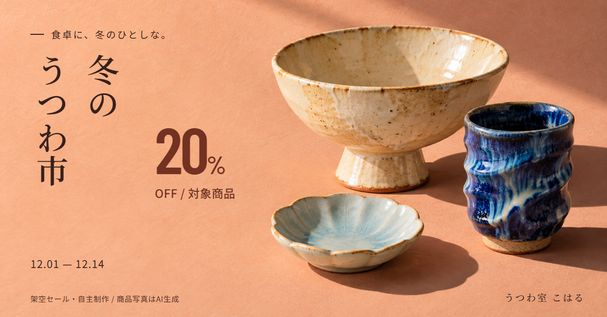
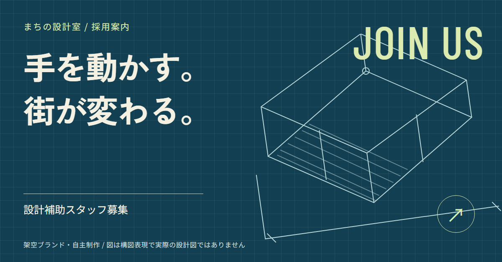
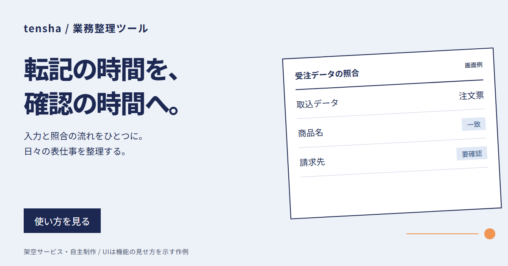

# バナー制作 作例集

セール告知、採用、SaaSの3つを、商材ごとに主役・書体・情報の並べ方を変えて制作しました。すべて架空案件・自主制作です。実在の取引先の広告や、成果を示す実績ではありません。

## セール告知 — 冬のうつわ市

商品と割引条件を一目で読める構成。商品写真はAI生成、文字は編集可能なHTMLテキストです。価格・割引・期間・ブランドはすべて架空の作例設定です。

## 採用 — まちの設計室

設計図をモチーフに、人物写真を使わず仕事の内容を伝えています。図は構図の表現で、実際の設計図ではありません。

## SaaS — tensha

入力から照合への流れを画面の断片で示し、業務上の使い方を訴求します。UI・機能・ブランドは架空の作例です。

---

全画像1200×628px。文字・価格・色・配置は各HTMLから編集できます。画像の無断転載・再販売はご遠慮ください。
